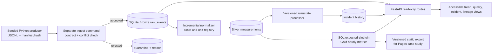
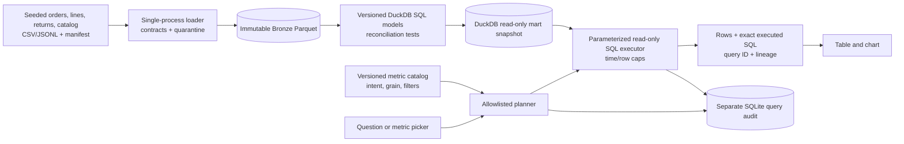
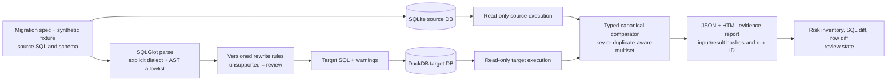

# Portfolio V2 — Gate 0 audit and Gate 1 architecture decision record

**Status:** DESIGN ONLY. No V2 application, deployment, or acceptance result is claimed.

**Scope:** personal repository `MariaCM34/MariaCM34.github.io`; synthetic data only.
**Baseline:** public `main`, local `origin/main`, and the starting point of local `portfolio-v2` all resolve to `adcbfa7175acd65eba4cc322c17ae6ac4f382c7a` at this checkpoint. Local preservation tag: `v1-preserved-adcbfa7`. The untracked overnight instruction file and supplied V2 package were preserved. No remote branch was created or pushed.

## Gate 0 — observed V1 behavior and evidence

| Route | Observed executable behavior | Missing engineering evidence | Classification |
| --- | --- | --- | --- |
| `/projects/energypulse/` | `fixture.mjs` generates 3 assets × 3 days × 24 hourly records = 216 records in browser JavaScript; `rules.mjs` evaluates thresholds; `app.mjs` filters, renders SVG, simulates replay, and exports CSV. | No independently running producer/consumer, persisted Bronze/Silver/Gold, incremental checkpoint, API, or source-to-alert database lineage. | Browser prototype |
| `/projects/ask-your-data/` | `app.js` loads 17 synthetic order lines; `engine.js` maps five regex intents and calculates aggregates in JavaScript. | Displayed SQL is never executed. No governed warehouse, currency-safe metric model, ingestion audit, or query isolation. The cancellation-rate illustrative SQL counts lines, not distinct eligible orders. | Browser prototype |
| `/projects/modernize-studio/` | `engine.mjs` accepts only three exact source strings and returns prewritten outputs; `compareRows()` checks bundled JavaScript arrays. | No AST-based translation, two executed database engines, typed comparison, or migration provenance. | Browser prototype |
| `/` and CI | Bilingual static showcase; `.github/workflows/test.yml` runs `node --test` and a limited regex secret check. Local `node --test` on this baseline: **23 passed, 0 failed**. | No V2 data contract, database/API integration, real SQL execution, browser E2E, or independent reconciliation. | V1 showcase, not proof of three end-to-end products |

The V1 READMEs disclose these limits honestly. Preserve the working pages while V2 develops. Neither an HTTP 200 nor 23 V1 unit/smoke tests is an end-to-end data-engineering acceptance result. No V2 tests were run because V2 has not been implemented.

### Audit challenges to the supplied specification

1. **Telemetry volume:** 24 assets × 30 days × 96 fifteen-minute slots = **69,120 asset-time slots**. At one event per each of three metrics, the full stream is **207,360 scalar events** before duplicates, invalid records, and gaps. State which unit a benchmark counts.
2. **No-data detection needs an expectation model.** A `GROUP BY` over received rows cannot reveal a missing sensor or empty hour. Define expected `(asset, metric, slot)` from an active-asset schedule and compare it with valid arrivals.
3. **An incident is a stateful entity, not one row per threshold breach.** Repeated breaches need a stable deduplication key and documented open/ack/close semantics. Public read-only mode cannot legitimately acknowledge incidents.
4. **Revenue semantics precede SQL syntax.** The V1 line-based cancellation count and return treatment would mislead on multi-line orders or partial returns. Define eligible orders, line grain, currency, return allocation, and reporting date before writing models.
5. **A parser is not a semantic validator.** SQLGlot may accept SQL that an engine rejects and may warn while producing a best-effort translation. A migration claim requires an explicit supported AST subset plus execution in both named engines. SQLite-to-DuckDB evidence cannot imply SQL Server-to-Snowflake equivalence.
6. **GitHub Pages is static.** It can host case studies and exported results from real runs, but not the FastAPI services. Do not label a prerecorded artifact as a live backend. Public interactive backend hosting is a separate, costed release decision.

## Cross-product engineering rules

- **Repository:** keep V2 under `v2/energy_pulse/`, `v2/governed_analytics/`, and `v2/migration_assurance/` in the existing personal repository. Each package owns its lockfile, migrations/models, tests, CI job, and docs. This avoids creating external repositories before review and prevents cross-project writes. Existing `projects/` and root `index.html` remain untouched through Gate 1.
- **Reproducibility:** pin Python and direct/transitive dependencies in committed lockfiles after a compatibility spike. A fresh clone must provide a one-command local path for each package. `make` is optional on Windows; equivalent `python -m ...` / PowerShell commands are mandatory. Docker is an optional parity route, not the only route.
- **Data:** deterministic synthetic generator, recorded seed, immutable input hash, schema version, UTC instants, currency/decimal conventions, and bounded fixtures. No production/customer data or credentials.
- **Execution:** separate generation, ingestion/build, service, and browser layers. UI numbers must come from persisted pipeline output through an API or a signed-off exported artifact. Published Pages content is explicitly a snapshot with run ID and timestamp.
- **Quality:** independent source-level or hand-calculated oracle, positive and adversarial fixtures, contract/integration/API/browser tests, failure recovery, structured logs, and coverage of critical business modules. Coverage is a diagnostic, not a substitute for reconciliation.
- **Security:** reject unknown schemas and unsafe inputs; use read-only query connections and bounded outputs; keep mutable operations local/authenticated; scan source and generated artifacts before publication. Localhost binding by default. Do not accept arbitrary SQL or customer files in a publicly hosted demo.

**Proposed package layout and operator interface (contracts, not implemented commands):**

```text
v2/
  energy_pulse/
    README.md  pyproject.toml  lockfile  Makefile  .env.example
    src/energy_pulse/{producer,ingest,models,rules,api,cli}.py
    migrations/  sql/  web/  data/synthetic/  tests/{unit,integration,e2e}/
    docs/{ARCHITECTURE,DATA_DICTIONARY,RUNBOOK,THREAT_MODEL,TEST_EVIDENCE}.md
  governed_analytics/
    README.md  pyproject.toml  lockfile  Makefile  .env.example
    src/governed_analytics/{generate,load,build,planner,api,cli}.py
    models/  metrics/  web/  data/synthetic/  tests/{unit,integration,e2e}/
    docs/{ARCHITECTURE,METRICS,QUERY_GOVERNANCE,TEST_EVIDENCE}.md
  migration_assurance/
    README.md  pyproject.toml  lockfile  Makefile  .env.example
    src/migration_assurance/{parser,rules,executor,comparator,report,cli}.py
    cases/  rules/  web/  reports/examples/  tests/{unit,integration,e2e}/
    docs/{ARCHITECTURE,DIALECT_SUPPORT,RULE_CATALOG,RUNBOOK,TEST_EVIDENCE}.md
.github/workflows/v2-validation.yml
```

The intended command surface is `python -m energy_pulse.cli demo`, `python -m governed_analytics.cli demo`, and `python -m migration_assurance.cli assess --case <reviewed-case-id>`, after package-local locked installation. Each `demo` must invoke distinct generate/load/build steps and print run ID, source/output counts, and local URL; it may not shortcut to bundled browser arrays. Windows PowerShell equivalents and CI commands will be specified and run at implementation time. Generated databases, logs, and reports stay ignored unless a bounded, sanitized evidence artifact is intentionally checked in.

## Product 1 — EnergyPulse: Industrial Telemetry & Data Quality Platform

**Buyer / outcome.** A fictional industrial energy-operations team needs to distinguish abnormal readings from missing or stale data and explain each incident. The saleable demonstration is an auditable local reference system, **not** safety-critical monitoring or live plant control.



**Stack and justification.** Python 3.12 as a conservative target, Pydantic for event/API validation, SQLite with WAL and versioned SQL migrations for a zero-secret, low-ops local reference, FastAPI for typed read-only HTTP, SQL for normalization/aggregation, vanilla TypeScript or JavaScript with SVG for the bounded dashboard, pytest and Playwright for integration/browser tests, GitHub Actions for CI. SQLite is adequate for one batch writer and concurrent readers at this demo scale; it is **not** a multi-writer industrial ingestion service. If measured lock contention warrants it, a future PostgreSQL adapter replaces storage behind the same contracts. No Kafka, Redis, Spark, dbt, or Docker daemon is required for the first vertical slice. An optional Compose/PostgreSQL profile must earn inclusion through an actual concurrency requirement.

**Contract and storage.** Source JSONL event v1 follows `examples/energy_event_v1.schema.json`, amended before implementation to require `source_id` and an explicit contract revision. One row represents one `(asset_id, metric, observed_at_utc)` observation. `event_id` is the transport idempotency key; `(source_id, asset_id, metric, observed_at_utc)` is a natural uniqueness check with a documented correction policy. JSON numbers must be finite; the schema's metric/unit enums must also enforce compatible pairs (`temperature/C`, `vibration/mm/s`, `pressure/bar`). Validate UTC offset, version, active asset, bounded future skew, quality flag, and range before Silver. `source_id`, `producer_run_id`, `ingest_run_id`, `ingested_at_utc`, `payload_sha256`, and `schema_version` preserve provenance. Bronze stores accepted immutable raw payloads; quarantine stores original rejected bytes, reason code, and run ID without corrupting Gold. Same ID + same hash is a no-op; same ID + different hash is `ID_CONFLICT` quarantine.

**Transforms and incremental behavior.** A transaction records the raw insert, checkpoint, and run counts. Silver is an upsert keyed by `event_id` with canonical units and validation status; Gold is recomputed only for affected `(asset, metric, UTC hour)` windows, including the old window if a correction is explicitly authorized. An expected-slot calendar, joined to active-asset cadence, yields `NO_DATA`, `PARTIAL`, `COMPLETE`, and `STALE`; zero is a valid measurement, never a missing sentinel. Late events inside a configurable 48-hour demo watermark update their event-time hour and run a deterministic incident recomputation. Older events go to `LATE_REVIEW` until an operator runs an explicit backfill; no silent omission. Incident identity is `(asset, metric, rule_version, contiguous breach episode start)`, with transitions `OPEN` and `CLOSED` produced by deterministic rule runs; `ACK` is excluded from the public API and requires an authenticated local operator workflow if later added. Rule revision and threshold are stored with each decision.

**API and experience.** `GET /health`, `/api/runs`, `/api/assets`, `/api/measurements`, `/api/quality`, `/api/incidents`, and `/api/incidents/{id}/lineage`; bounded UTC intervals, page size, explicit units and status, no public writes. The UI offers asset/time/signal filters, quality heatmap, multi-series trend with accessible table fallback, incident detail with source event ID and rule revision, freshness/run timestamp, loading/empty/error states, and synthetic-data banner. A point click must retrieve—not synthesize—the persisted lineage path. The Pages case study uses a generated run artifact and links exact commit, source files, test log, and local replay command; it is labeled a snapshot.

**Example contract path (planned, not observed):** `evt-a102-20261015T101500Z-temp` carrying 84.3 °C at 10:15 UTC → Bronze raw payload/hash → Silver `event_id` + canonical 84.3 °C → Gold 10:00–10:59 slot count and `avg_temperature_c` → `temp-high-v1` rule (`84.3 > 80`) → incident lineage API → chart detail. The sample is synthetic; exact row IDs and output counts must be captured from a future execution, never preclaimed.

**Observability, security, cost, limits.** JSON logs and `pipeline_runs` record accepted/duplicate/quarantined/late/output counts, duration, watermark, and code version. Tests inject duplicate/conflicting IDs, invalid unit/NaN, unknown asset, no data, late arrival, crash after Bronze, and backfill retry. Default binds API to localhost; cap request range and response size. Local software and Pages snapshot require no paid service; estimated demo resource budget is one laptop process, under ~1 GB database for ~207K scalar events plus indexes/JSON (to be measured), with disk and runtime recorded in CI. Cloud hosting, 24/7 SLA, authentication, calibration, and industrial-grade queueing are **outside** this reference scope.

## Product 2 — Governed Analytics: Executable SQL & Business Analytics Platform

**Buyer / outcome.** A fictional retail analytics team needs consistent revenue, returns, and cancellation answers with visible SQL and refusal of unsupported questions. Release name: **Governed Analytics Explorer** until a real, evaluated LLM exists; no “AI copilot” claim.



**Stack and rationale.** Python 3.12, DuckDB for analytical SQL over local Parquet with a single build writer and read-only serving, Pydantic for import/request contracts, FastAPI, committed SQL model files, a YAML/JSON semantic catalog, minimal accessible JS charts, pytest/Playwright, and GitHub Actions. Avoid dbt initially: at this scale its adapter/toolchain adds installation and compilation risk without a demonstrated need; SQL model dependency order and tests are explicit. DuckDB's documented single-process write model is handled by building a versioned snapshot offline, closing the writer, then opening it read-only in the API. Audit writes go to separate SQLite. A new snapshot is promoted only after all model tests pass; the API restarts or reloads at a defined boundary, with no multi-process DuckDB writer assumption.

**Contracts, grain, and metrics.** Source entities: `orders(order_id, placed_at_utc, status, currency, customer_synthetic_id)`, `order_lines(line_id, order_id, product_id, quantity, unit_price_minor, discount_minor)`, `returns(return_id, line_id, accepted_at_utc, returned_quantity, refund_minor)`, `products(product_id, category_id, effective_from_utc)`. Use integer minor currency units; reject unknown currency, negative amount, impossible quantity/discount, missing product, and refund greater than the line's eligible paid amount. Bronze preserves source payload/hash/run. Silver deduplicates event IDs and validates referential integrity. Mart grain: one order line for `fct_order_line`, one accepted return event for `fct_return`, one order for `fct_order_status`; never join raw returns to line facts before aggregating refunds or a one-to-many join will double revenue. Product category is effective-dated or explicitly immutable in the demo.

`gross_sales` = completed-line pre-discount minor units. `net_sales` = completed-line value after discount less accepted refund amounts, with refund recognized on **accepted return date**; the monthly sales and refunds components are shown separately before subtraction. `cancellation_rate` = distinct cancelled eligible placed orders / distinct eligible placed orders in the placement-time window. Group by currency; **no cross-currency total or conversion**. Reporting timezone defaults to UTC and is shown; a Bogotá display is a presentation conversion, not a hidden change to reporting buckets. Catalog revision `metrics-v1` binds metric ID, SQL model, grain, currency/time/date rules, and display formula; any change requires oracle and snapshot review.

**Incremental and query behavior.** Source event IDs and hashes make repeated loads no-ops and altered duplicates conflicts. Partition Bronze by source/UTC date; rebuild only affected month partitions and validate source-versus-mart counts/sums before promotion. To keep the demo deterministic, the first implementation may rebuild the small snapshot fully; label that honestly and add incremental promotion only after its failure tests pass. The planner accepts a small enumerated set of metric actions and typed date/category/currency parameters. It renders a reviewed `SELECT` template with placeholders, executes that same SQL on a read-only DuckDB connection, and returns the exact statement, redacted/bound parameters, query ID, rows, elapsed time, source snapshot hash, and metric version. An unsupported free-text question or any attempt at arbitrary SQL is refused, audited, and clears previous results. Because the user cannot submit SQL, an AST guard is unnecessary in the first release; adding free-form SQL would require separate parsing, semantic authorization, and sandboxing.

**API, UI, observability, cost, limits.** `GET /api/catalog`, `POST /api/query` (typed metric request only), `GET /api/queries/{id}` for local audit; response cap 500 rows, query-time budget tested with cancellation, bounded dates, no PII. UI shows metric formula, grain, currency, filter, executed SQL, query/run IDs, labeled time series, matching table, source counts, no-data/error/refusal states. Structured logs capture load/model/query run IDs, rejected rows, elapsed time, and snapshot version. Local zero-paid-service operation is expected; ~10K seeded order/return events plus Parquet/mart artifacts should fit a normal laptop, but disk and execution time must be measured before publication. Public Pages can show a genuine CI-exported result, not accept arbitrary live questions without an independently hosted service.

**Example (planned):** a three-line order with two accepted partial returns is loaded once; line facts total the completed sale, return facts total only accepted refunded minor units; the monthly query subtracts the refund in its acceptance month. An independent fixture oracle, implemented without calling model SQL or the application metric function, must reconcile every displayed monthly point and prove the cancellation denominator counts the order once.

## Product 3 — Migration Assurance Studio: SQL Migration & Data Reconciliation Platform

**Buyer / outcome.** A data-platform migration lead needs a bounded evidence package that separates syntactic translation from observed result equivalence. The first executable pair is **SQLite → DuckDB**; T-SQL → Snowflake remains a documented compatibility study until both proprietary engines can actually be tested.



**Stack and rationale.** Python 3.12, SQLGlot with source and target dialect set explicitly and unsupported translations configured to raise, actual SQLite and DuckDB engines in separate database files, Pydantic spec validation, HTML report first, optional local FastAPI UI after report correctness, pytest differential/property-based tests, and GitHub Actions. SQLGlot is a translator, **not** proof of semantic equivalence; node allowlisting, schema/type checks, engine execution, and comparator are separate gates. An HTML report may be sufficient for the first slice; React and a continuously running API are deferred unless the review workflow demonstrably needs them.

**Contract and storage.** `migration_case_v1` declares `case_id`, source/target dialect and engine versions, schema/fixture digests, source SQL hash, expected row grain or key, comparison mode (`keyed` or `multiset`), column map, type normalization rules, exact decimal scale/tolerance, timestamp timezone, ordering requirement, unsupported-construct policy, and ruleset revision. Inputs are versioned synthetic files only; source/target fixtures load independently into separate DBs. Source and target executed rows are persisted as bounded JSON/Parquet evidence with hashes. Reports include SQL, AST warning inventory, run timestamp, versions, row counts, type/null/duplicate/key differences, sample discrepancies, and `PASS`/`FAIL`/`REVIEW` status. SHA-256 is an integrity digest, **not** an identity signature or certification; a real signature would require a managed signing key outside the public repo.

**Processing, idempotence, errors.** Parse exactly one allowlisted read-only `SELECT`; reject DDL/DML, multiple statements, UDFs, dynamic SQL, unsupported hints/procedures, ambiguous `TOP` without deterministic ordering, and type-sensitive rewrites without schema. Convert via versioned AST rules and record every applied rule. Create a run ID from case + input digests + engine/rules versions; a replay with identical inputs yields the same comparison verdict (timestamps may differ) and does not overwrite prior immutable evidence. A failed parse/engine query becomes `REVIEW` or `FAIL`, never a successful translation. Execute each engine in read-only mode with fixture size and timeout limits; public UI never accepts untrusted arbitrary SQL. Compare keyed rows by declared business key; if absent, use duplicate-aware multiset counts. Normalize only declared types; decimal comparisons use exact values or a stated tolerance, and SQLite floating-point/affinity limitations force `REVIEW` for claims it cannot prove. Ordering is compared only if the source query explicitly promises deterministic order; otherwise report result-set equivalence without order claims.

**API/UI, observability, cost, limits.** A CLI `assess` produces the primary auditable JSON/HTML artifact. Optional local `GET /api/runs/{id}` and `GET /api/runs/{id}/diff` serve persisted results; no public write route. UI shows supported constructs, source/target SQL diff, rule warnings, engine versions, per-key differences, and an exportable report. Structured run logs record parse/execute/compare stages, input hashes, timing, and failure reason. Local SQLite/DuckDB execution and static report hosting incur no required paid service; estimate a laptop-only run with tens of synthetic fixture rows for each of at least ten different query cases, with actual runtime/storage measured in CI. This proves only the exercised local dialect pair and fixture coverage, not semantic equivalence for all data or a real cutover. Human DBA review, proprietary engine tests, deployment plan, and rollback remain explicit prerequisites for customer use.

**Example (planned):** both engines query synthetic `A-001.amount = 10.00`. After deliberately changing the target fixture to 11.00, the report must contain `A-001.amount: expected 10.00; actual 11.00`, a changed target input hash, and `FAIL/BLOCKED`. A successful row-count-only check is insufficient.

## Critical review and design trade-offs

| Concern | Decision / reason | Residual risk and gate |
| --- | --- | --- |
| Complexity | One personal monorepo with three isolated packages; no new repos or Kafka/Kubernetes/Spark/LLM by default. | Dependency boundaries enforced by package-local CI and review; split repos only if ownership/release cadence justifies it. |
| Storage contention | Energy uses single-writer SQLite/WAL; Analytics builds DuckDB offline then serves read-only; Migration runs separate engines per case. | Load/lock tests must validate assumptions. Do not market as horizontally scalable. |
| Security | Public Pages is static; local APIs bind localhost; bounded typed parameters; migration SQL only from reviewed fixtures. | A future hosted service needs authentication, rate limits, abuse isolation, and paid-cost review before deployment. |
| Maintainability | Versioned contracts, SQL models, rules, migrations, run manifests, and ADRs; avoid duplicating metric formulas in UI. | Golden fixtures can become stale; semantic version changes require independent review. |
| Correctness | Independent oracles, negative fixtures, source-to-output IDs, declared grains and calendars. | Synthetic fixtures cannot cover all industrial or commercial edge cases. Claim scope remains reference implementation. |
| Observability | Run IDs, counts, rejected records, versions, hashes, structured errors and recovery commands in each package. | Local logs are not a production monitoring/SLA service. |
| Cost | All three baseline executions run locally and Pages serves static evidence. No paid account is required. | Electricity, developer time, CI quotas, and any future public backend hosting are excluded from “$0 incremental service spend”; publish measured artifact sizes and CI minutes at Gate 5. |

Primary documentation supporting the platform constraints: [GitHub Pages does not execute server-side Python](https://docs.github.com/en/pages/getting-started-with-github-pages/creating-a-github-pages-site), [Pages availability on GitHub Free public repositories](https://docs.github.com/en/pages/configuring-a-custom-domain-for-your-github-pages-site/about-custom-domains-and-github-pages), [SQLite WAL's single-writer/concurrent-reader behavior](https://www.sqlite.org/wal.html), [DuckDB concurrency model](https://duckdb.org/docs/current/connect/concurrency), [DuckDB Parquet support](https://duckdb.org/docs/current/data/parquet/overview), and [SQLGlot parser/transpiler behavior and unsupported errors](https://sqlglot.com/sqlglot). These inform the architecture; library compatibility and exact versions remain to be verified in the implementation spike.

## Implementation backlog, dependencies, and estimated effort

The estimate is **engineering judgment, not observed throughput**. Assumptions: one experienced engineer, part-time reviewer, Windows local development plus GitHub Actions, no customer integration, no hosted mutable backend. Ranges include documentation and failure tests; dependency installation and browser support may widen them.

| Order | Work package | Prerequisite | Estimated engineer-days | Exit evidence |
| --- | --- | --- | ---: | --- |
| 0 | Approve architecture/contracts and decide whether the static snapshot is an acceptable public interaction model | This checkpoint | 1–2 | Reviewed ADRs, metric/rule definitions, no unresolved business semantics |
| 1 | Shared tooling spike: Python/version/lock, CI runners, local command, fixture schema validation | Gate 1 review | 2–3 | Fresh-clone install on Windows and CI, dependency/secret scan |
| 2 | Energy vertical slice: producer → ingest → Bronze/Silver/Gold → API → one chart/trace | 1 | 6–9 | Persisted event ID through every layer, duplicate/conflict/late/no-data cases |
| 3 | Energy hardening: incremental retry, incident lifecycle, UI states, load evidence, docs/review | 2 | 4–6 | Full Energy acceptance matrix and independent sign-off |
| 4 | Governed Analytics: source contracts, marts, semantic planner, API/UI, independent reconciliation | 1; Energy pattern stable | 7–11 | SQL executed and audited; multi-line/partial return/currency/security gates |
| 5 | Migration Assurance: AST subset, two engines, typed comparator, reports/UI, differential tests | 1; separate fixtures | 9–14 | Ten executed cases, deliberate mismatch, unsupported-node refusal |
| 6 | Showcase integration and independent review; static evidence exports, visual/accessibility checks | 3–5 | 4–6 | Accurate maturity labels, CI, Pages links, reviewer record |

**Total planning range:** roughly **33–51 engineer-days**, or 7–11 working weeks for one engineer, plus reviewer availability. This is a scoped estimate, not a deadline guarantee. The three paths are not equally parallel: Energy establishes the evidence pattern first. At any release cut, publish only packages whose gates passed; keep the V1 website until then.

## Acceptance gates and evidence to capture

1. **Gate 0 — preserved:** `main`, `origin/main`, and remote `main` resolve to the recorded V1 SHA; preservation tag exists; unrelated/untracked files remain untouched. **Passed locally and via GitHub metadata at this checkpoint.**
2. **Gate 1 — design:** buyer, contracts/grains, sample data flow, diagrams, stack/alternatives, failure policy, security, cost boundary, and testable gates exist for all three products. **This document is the proposed deliverable; awaits human architecture review.**
3. **Gate 2 — Energy vertical slice:** fresh clone command produces independently generated source files, persisted raw/clean/gold rows, one real API response and chart, one traceable ID; duplicate, conflict, late, invalid and zero-data tests pass. No UI-only substitution.
4. **Gate 3 — per-product correctness:** Analytics proves executed SQL and independent money/order reconciliations; Migration proves ten distinct AST cases executed in two actual engines and catches intentional mismatch. Each has unit, integration, contract, API/report, browser E2E where applicable, and negative tests.
5. **Gate 4 — operational quality:** pinned reproducible setup, structured run logs, restart/backfill tests, critical-module coverage report with exclusions, bounded performance measurements with machine/environment, dependency/security scans, accessibility at mobile/desktop, complete runbooks and threat models.
6. **Gate 5 — independent review:** reviewer who did not build the package runs fresh clone and checks actual output IDs, code paths, calculations, failure modes, and claims against `quality/REVIEW_CHECKLIST.md`; no self-approval.
7. **Gate 6 — release:** only reviewed evidence is integrated into public Pages; static snapshots say when/how they were generated and link runnable source. CI at exact commit and anonymous public HTTPS routes are checked. A public backend requires a separate approved hosting/security/cost design.

## Open decisions for architecture review

1. Is a **local executable reference implementation plus Pages snapshot** the desired public product boundary, or is a remotely hosted interactive API required? The latter changes threat model, operating cost, and schedule.
2. Should Energy's first supported unit set remain exactly `C`, `mm/s`, `bar` and one 15-minute cadence per metric? Variable cadence/calibration increases contract complexity.
3. Confirm Analytics return recognition on acceptance date, eligible-order denominator, and whether multi-currency data should be split only (recommended) or converted using a dated FX source (defer).
4. Confirm Migration's first pair SQLite → DuckDB and the narrow supported SQL subset. A T-SQL → Snowflake headline should be deferred until actual engine access and test rights exist.
5. Confirm whether any professional biography/claims on the V1 homepage need owner review before V2 case-study publication; technical demos must remain separate from career claims.

**Checkpoint stop:** no V2 product code, implementation agent, new repository, push, PR, or deployment is authorized by this Gate 1 document. Proceed only after the owner's architecture review.
