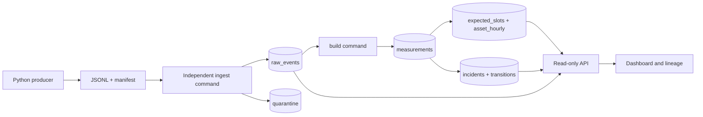

# EnergyPulse V2 — synthetic telemetry reliability reference

**Status:** independently reviewed and CI-validated local reference implementation; not published as a V2 Pages product. All assets, readings, incidents and sites are synthetic. Not for safety-critical control or live operations.

An industrial energy-operations team needs to see whether a sensor is abnormal, missing or stale, and trace a decision to its original reading. EnergyPulse separates a deterministic JSONL producer, a contract-checking ingestion process, SQLite Bronze/Silver/Gold layers, a versioned incident processor, a read-only FastAPI service and a browser dashboard. The [static showcase](../showcase/README.md) contains a clearly labeled frozen export from an executed run; GitHub Pages cannot run this backend.



## Reproduce on Windows PowerShell

Use Python 3.12. From the repository root (the commands below use the standard `py` launcher; substitute a Python 3.12 executable if needed):

```powershell
py -3.12 -m venv v2/.venv
v2/.venv/Scripts/python.exe -m pip install -r v2/requirements.lock
v2/.venv/Scripts/python.exe -m pip install --no-build-isolation -e v2/energy_pulse
v2/.venv/Scripts/python.exe -m energy_pulse.cli seed --out v2/energy_pulse/data/generated/events.jsonl --slots 96
v2/.venv/Scripts/python.exe -m energy_pulse.cli ingest --db v2/energy_pulse/data/generated/energy.sqlite --source v2/energy_pulse/data/generated/events.jsonl
v2/.venv/Scripts/python.exe -m energy_pulse.cli build --db v2/energy_pulse/data/generated/energy.sqlite --manifest v2/energy_pulse/data/generated/events.manifest.json
v2/.venv/Scripts/python.exe -m energy_pulse.cli serve --db v2/energy_pulse/data/generated/energy.sqlite --port 8876
```

Open `http://127.0.0.1:8876/`. The convenience `python -m energy_pulse.cli demo --out-dir ...` runs seed, ingest and build in separate subprocesses and prints the final server command. The standard path intentionally shows each boundary separately.

On macOS/Linux replace the virtual-environment executable with `v2/.venv/bin/python`. In CI use Python 3.12 and the same pinned lockfile. Docker is optional; it is not needed for this SQLite implementation.

## Five-minute guided investigation

1. Run the three commands and note producer SHA-256, ingest run ID, accepted count, build run ID and Gold row count. The default seed emits 862 synthetic scalar events from 864 expected slots, omitting two Chiller pressure readings.
2. Open the dashboard and choose **Pump A102 / Temperature**. Select the incident. The lineage view shows source event `EVT-PUMP-A102-20261015T0115Z-TEMPERATURE`, raw payload hash, normalized 84.3 °C, Gold hour and `temp-high-v1` threshold 80 °C. These values must be read from the executed pipeline, not copied from this prose.
3. Choose **Chiller C301 / Pressure**. The first two hours are `PARTIAL` because expected slots exist without source events. No missing value is displayed as zero.
4. Re-run ingestion with the same source: accepted 0, duplicate 862, unchanged Silver/Gold/incident IDs. Alter one line's value while retaining its ID and ingest it: the `ID_CONFLICT` row appears in quarantine; Gold stays unchanged.
5. Run `v2/.venv/Scripts/python.exe -m pytest v2/energy_pulse/tests -q` and inspect the negative and late-arrival tests.

The default count is derived from the generator design (3 assets × 3 metrics × 96 slots − 2 missing), and is a fixture expectation, not a measured production claim. Actual output should always be taken from the command and database.

## Current scope and evidence

The local 12-slot run used separate producer/ingest/build processes: 106 emitted and accepted, 106 Silver rows, 27 Gold rows, one incident. Independent review fixed false coverage and lineage cases, and clean-checkout CI passed the integration, negative, and browser tests. The current evidence is in [TEST_EVIDENCE.md](docs/TEST_EVIDENCE.md). Performance and operational scale remain unmeasured; no V2 Pages deployment has occurred.

See [architecture and grain](docs/ARCHITECTURE.md), [data dictionary](docs/DATA_DICTIONARY.md), [operations](docs/RUNBOOK.md), [security](docs/THREAT_MODEL.md), and [trade-offs](docs/ADRS/001-batch-vs-queue.md).
