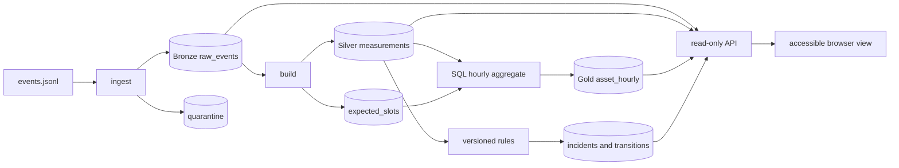

# EnergyPulse architecture and data flow

The source is a seeded Python producer with no database access. It writes JSONL plus a manifest containing seed, expected/emitted counts, UTC start and source SHA-256. The ingestor validates the versioned event contract and writes immutable accepted payloads to `raw_events`; invalid records and conflicting IDs go to `quarantine`. A separate build command normalizes new raw events into `measurements`, constructs expected 15-minute asset/metric slots, executes SQLite SQL from `sql/rebuild_gold.sql` for affected UTC hours, and computes deterministic threshold episodes. FastAPI uses read-only SQLite connections. The dashboard only calls the API.

One accepted source event is one asset/metric/15-minute slot across all source IDs; migration 003 enforces this global key. Gold grain is `(asset_id, metric, UTC hour)` and incident grain is one observed threshold-breach episode under one rule version. Stable incident IDs derive from asset, metric, rule version and episode start. A gap does not prove recovery: `gap_count` records missing slots and the incident closes only with a GOOD nonbreach measurement, whose event ID is retained in the transition. Event time determines Gold hour, not ingestion time. A build recomputes only hours receiving new expected slots or new accepted Silver measurements; incident episodes are recomputed from persisted Silver when measurements change. The 48-hour lateness watermark is relative to the greatest previously normalized event time, not wall-clock time. Older events remain in Bronze as `LATE_REVIEW`; events outside the expected calendar are `OUTSIDE_CALENDAR`. Either requires explicit reviewed backfill after calendar inspection or extension.

`GET /api/incidents/{id}/lineage` returns the incident, first source raw event/hash, normalized measurement, Gold hour and transition records. The API does not mutate data. `GET /api/quality` makes expected-versus-received counts visible even when zero GOOD readings exist.

**Trade-offs:** SQLite WAL supports one local writer with concurrent readers but not distributed writes. Recomputing all incident episodes is simple and deterministic at this demonstration scale; a much larger fleet would partition that work. The threshold is illustrative, not calibrated to real equipment. The current local UI presents data from the API; no public hosted API exists.
