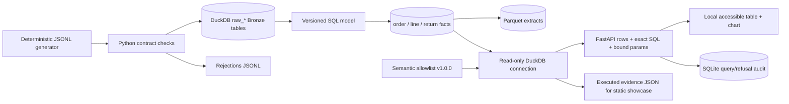

# Governed Analytics Explorer (V2)

**Status:** local executable reference implementation with invented data. It is not a hosted analytics service, a customer deployment, or a generative AI agent.

An ecommerce analytics team needs consistent sales/refund definitions and a way to answer routine questions without handing users unrestricted SQL. This implementation generates orders, lines, returns and a product catalog; validates and persists them; builds DuckDB fact tables and Parquet extracts; runs versioned, parameterized SQL through a local FastAPI application; and shows the exact executed statement and result in a browser. Rebuilding the same source snapshot is idempotent. The default seed has 12,723 synthetic source records.



## Quickstart

From the repository root with Python 3.12 (one-time setup, then run):

```powershell
py -3.12 -m venv v2/.venv
& v2/.venv/Scripts/python.exe -m pip install -r v2/requirements.lock
$env:PYTHONPATH='v2/governed_analytics'
& v2/.venv/Scripts/python.exe -m analytics.pipeline all
& v2/.venv/Scripts/python.exe -m pytest v2/governed_analytics/tests -q
& v2/.venv/Scripts/python.exe -m uvicorn analytics.api:app --host 127.0.0.1 --port 8766
```

Open `http://127.0.0.1:8766/`. On macOS/Linux use `PYTHONPATH=v2/governed_analytics v2/.venv/bin/python -m ...` for the same modules. To regenerate public evidence after a verified build:

```powershell
& v2/.venv/Scripts/python.exe -m analytics.export
```

The generated warehouse, Parquet files, audit DB, JSONL fixtures and export live in ignored `data/`; no customer input or credential is needed. `python -m analytics.pipeline build` reloads existing JSONL without regenerating the seed. See [operations](docs/OPERATIONS_RUNBOOK.md), [definitions](docs/METRICS.md), [schema](docs/DATA_DICTIONARY.md), and [security](docs/QUERY_GOVERNANCE.md).

## Scope and trade-offs

The buyer is a small analytics team validating definitions, not an organization requiring concurrency, authentication, SLA, or row-level privacy controls. DuckDB is a strong local OLAP engine with Parquet export and fast analytical queries; its snapshot is built offline and opened read-only by the API. SQLite keeps audit writes separate. SQL models are plain versioned files; dbt adds little at this model count. The deterministic planner supports four named metrics and typed filters. It refuses arbitrary text/SQL rather than claiming natural-language or LLM capability.

Revenue amounts are **integer minor units** and are never summed across currencies. UTC is the reporting calendar. Accepted returns reduce net sales in the *acceptance month*, which can make a month negative. Cancellation rate is order-grain. No FX conversion, tax, shipping, exchange-rate history, real customers, or real AI integration is included. Local operation requires no paid service; developer time, CI quotas, and future hosting are outside that cost boundary. A public Pages export is a frozen snapshot, not a live API.
