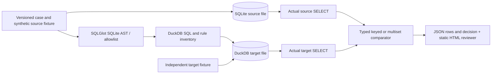

# Migration Assurance — executable SQLite → DuckDB evidence

**Maturity: local reference implementation.** This is a synthetic, bounded migration-assurance workflow for a data-platform migration lead. It demonstrates how to separate syntactic SQL translation from observed result agreement. It does **not** certify a production cutover or equivalence for SQL Server, Snowflake, untested data, or unsupported SQL constructs.

The commercial failure case is a query that parses and returns plausible totals after migration but changes a record, duplicate count, NULL, or ordering semantics. The deliberate target fixture changes `A-001.amount` from `10.00` to `11.00`; the executed comparison returns `FAIL` with the exact row and field.



## Five-minute local quickstart

Python 3.12 is the supported baseline. From repository root in PowerShell:

```powershell
py -3.12 -m venv v2/.venv
v2/.venv/Scripts/python.exe -m pip install -r v2/requirements.lock
$env:PYTHONPATH='v2/migration_assurance/src'
v2/.venv/Scripts/python.exe -m migration_assurance.cli suite --out v2/migration_assurance/artifacts/demo
v2/.venv/Scripts/python.exe -m pytest -q v2/migration_assurance/tests
v2/.venv/Scripts/python.exe -m http.server 8765 --directory v2/migration_assurance/artifacts/demo
```

Open `http://localhost:8765/` while the HTTP server runs. The server serves static reports and never accepts SQL. The `suite` command returns zero only if all 17 expected decisions match: 11 distinct PASS queries, two deliberate FAIL cases, and four REVIEW refusals. Every PASS/FAIL case has separate executed row output files for both engines. A single trusted local JSON case can be run with `python -m migration_assurance.cli assess --case PATH --out PATH`; this command returns 2 for FAIL/REVIEW. Do not expose that CLI as an untrusted public SQL API.

On macOS/Linux use `python3.12 -m venv v2/.venv`, `v2/.venv/bin/python`, and `PYTHONPATH=v2/migration_assurance/src`. The shared lockfile is owned by the V2 coordinator; this package requires its pinned `duckdb`, `sqlglot`, and `pytest` versions. No Docker or paid service is required.

## What the reviewer can do

Filter exported cases by PASS, FAIL, or REVIEW; inspect source and translated SQL, actual engine versions and row counts, the A-001 field-level mismatch, declared comparator, file/result hashes, and both persisted executed outputs. The browser modifies only the evidence view. It does not issue SQL or infer results from a hardcoded chart.

See [Architecture](docs/ARCHITECTURE.md), [Data dictionary](docs/DATA_DICTIONARY.md), [Dialect support](docs/DIALECT_SUPPORT.md), [Rule catalog](docs/RULE_CATALOG.md), [Differential tests](docs/DIFFERENTIAL_TESTS.md), [Runbook](docs/MIGRATION_RUNBOOK.md), [Security and risks](docs/RISKS.md), and [test evidence](docs/TEST_EVIDENCE.md).
