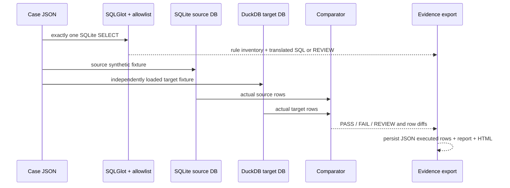

# Architecture and lineage

## Decision boundary

SQLGlot parses SQLite SQL and renders DuckDB SQL. Its output is a **candidate translation**, not proof of equivalence. The only PASS claim is observed equality for the exact independently loaded synthetic fixtures, actual SQLite/DuckDB versions, and declared comparator. A different fixture or engine release requires another run. Unsupported AST nodes become REVIEW and are never silently rewritten.

## Component map

| Module | Responsibility |
|---|---|
| `src/migration_assurance/engine.py` | Contract validation, AST gate, independent DB load/read-only execution, type normalization, comparison, provenance. |
| `src/migration_assurance/suite.py` | Explicit reviewed case definitions and expected decisions. |
| `src/migration_assurance/cli.py` | Reproducible runner and nonzero exit on unexpected suite decision. |
| `src/migration_assurance/html.py` | Escaped, dependency-free static review interface. |
| `data/*.json` | Synthetic fixtures, including deliberate value and missing-key faults. |
| `tests/test_engine.py` | Executed positive and adversarial checks. |

`suite` copies fixture inputs into the output directory, writes each versioned case JSON, creates independent temporary database files, executes one query on each, then saves `*-executed-rows.json`, `*-report.json`, and `*-report.html`. Database files are intentionally disposable; cases and executed outputs persist for inspection. New run IDs preserve old evidence rather than replacing reports. The `index.html` viewer is a snapshot of those real runs, not a live database endpoint.

## Technology choices

- **SQLite** represents the locally executable source and is built into Python; its decimal affinity may use binary floating point. The comparison contract declares scale and tolerance. This cannot model every legacy engine behavior.
- **DuckDB** represents the locally executable target, with native DECIMAL and efficient local analytical execution. It is a different engine and is loaded into a different file from a separate fixture.
- **SQLGlot** gives an inspectable AST and dialect render with unsupported errors. The allowlist narrows its broad feature set; unsupported SQL is not opportunistically converted.
- **Python/pytest** make the same CLI and differential tests runnable locally and in CI. Static HTML makes evidence inspectable on GitHub Pages without a secret-bearing backend.

Kafka, Spark, a hosted API, and a SQL Server/Snowflake connection are absent because they add cost and security requirements without proving this narrow pair. The latter pair must not be marketed as executed or equivalent.

## Operating envelope and cost

The CLI caps SQL at 8,000 characters, input at 1,000 rows per fixture and output at 1,000 rows per engine. It is intended for a trusted local engineer and tiny synthetic data. The application has no paid service dependency; developer time, laptop power, CI quotas, and any future hosting are real but have not been measured here. No production SLA or horizontal scaling is claimed. A public SQL service would require separate isolation, authentication, timeout/resource controls, and cost review.
